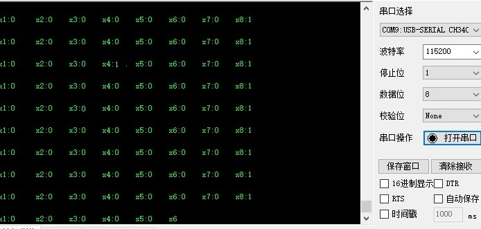

# MSPM0-IO 方式

[toc]

## 实验准备
1. MSPM0G3519主板
2. 8路巡线模块
3. 杜邦线若干

MSPM0G3519板子需要下载资料提供的IO通信源码

## 实验目的
此实验的内容主要是利用MSPM0G3519主控通过IO的方式接收8路巡线模块的数据。


## 实验接线
**MSPM0G3519接串口助手**
如果msp的type-c口没有下载程序的功能，需要用usb转ttl模块接到电脑，接线下表说述

|MSPM0G|usb转ttl|
|:------:|:--------:|
|PA10|TX|
|PA11|RX|
|vcc|vcc|
|GND|GND|
|**如果MSPM0G3519单片机type有下载功能，直接用type-c接入电脑的串口助手即可**||

|MSPM0G|8路巡线模块|
|:------:|:--------:|
|PA28|x1|
|PA31|x2|
|PA02|x3|
|PB24|x4|
|PB20|x5|
|PB19|x6|
|PB18|x7|
|PA07|x8|


## 实验步骤和现象
1. 把线连接好后，打开串口助手，就能看到红外模块的数值型数据了。波特率设置成115200。
如下图所示



**需要MSPM0的开发把环境搭建好,才能编译运行工程**
环境搭建教程:
https://wiki.lckfb.com/zh-hans/dmx/beginner/install.html

## 实验部分源码
```C
//主函数
int main(void)
{
    SYSCFG_DL_init();
	

	//等待红外模块正常 
	delay_ms(1000);
	delay_ms(1000);
	delay_ms(1000);
	delay_ms(1000);
	
	 //清除串口中断标志
    NVIC_ClearPendingIRQ(MYUART_INST_INT_IRQN);
    //使能串口中断
    NVIC_EnableIRQ(MYUART_INST_INT_IRQN);

	
	
    while (1) 
    {    
				printf_LineWalking();
				delay_ms(200);	
       
    }
} 
```
源码的主函数就很简单，读取8路巡线的探头引脚，并打印出来。


